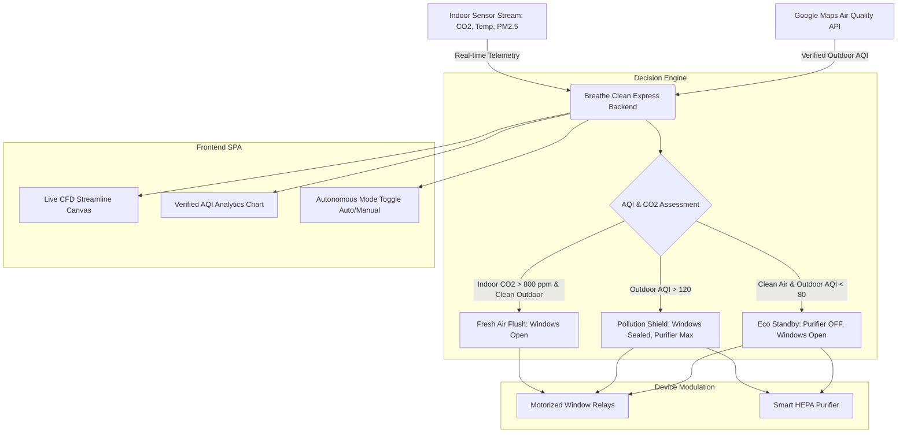

# 🍃 Breathe Clean
### *Autonomous Indoor Air Quality & Intelligent Ventilation Platform*

[](https://developer.mozilla.org/en-US/docs/Web/JavaScript)
[](https://nodejs.org)
[](https://expressjs.com)
[](https://www.sqlite.org)
[](https://developers.google.com/maps/documentation/air-quality)
[](https://nodejs.org/api/test.html)
[](LICENSE)

---

## 🏆 Project Overview

**Breathe Clean** is an autonomous indoor environmental orchestration platform built for smart campuses, commercial facilities, and modern homes. It intelligently bridges architectural aerodynamics with smart hardware automation:

1. **Natural Ventilation First**: When outdoor air is crisp and clean, motorized window actuators open automatically for natural fresh air circulation.
2. **Eco Standby Energy Conservation**: When indoor and outdoor air quality are healthy, air purifiers automatically power down to eliminate redundant electrical draw.
3. **Pollution Shield**: During outdoor smog spikes or hazardous particulate events, windows instantly seal, HVAC switches to safe indoor recirculation, and purifiers ramp up to Turbo CADR.
4. **Deterministic & Explainable AI**: Every automated action is governed by deterministic ASHRAE 62.1-aligned environmental rules with zero hallucinated decisions.
5. **Session-Authenticated Multi-Account Security**: Built-in SQLite-backed session store with scrypt password hashing and user-isolated device and sensor configurations.

---

## 📸 System Showcase

| Master Facility Actuation Console | Smart Hardware Pairing (Setup Mode) |
|:---:|:---:|
|  |  |

| Privacy-Preserving Telemetry & Zone Actions | Real-Time CFD Room Airflow Simulation |
|:---:|:---:|
|  |  |

---

## ✨ Key Features & Architecture

### 1. 🛰️ Verified Environmental Telemetry (Google Maps Platform)
* Integrates with **Google Maps Platform Air Quality API (Universal AQI)** for verified outdoor atmospheric telemetry (hourly history, AQI categorizations, and pollutant breakdowns).
* Coordinates and Indian city lookups powered by **Google Maps Geocoding API**, with manual coordinate entry fallback and GPS auto-detection.

### 2. 💨 Dynamic CFD Streamline Particle Simulator
* High-performance HTML5 Canvas 2D fluid dynamics particle engine rendering real-time indoor aerodynamics across rooms (Bedroom, Living Room, Study):
  * 🟢 **Natural Fresh Air** (Green streamlines from motorized windows)
  * 🔵 **Central HVAC Airflow** (Cyan streamlines from ceiling supply diffuser)
  * 🟣 **HEPA Purified Stream** (Purple laminar flow from cylindrical floor unit)

### 3. 🤖 Autonomous Explainable Rule Engine
* Authoritative decision engine implementing ASHRAE 62.1 indoor ventilation guidelines:
  * **Rule 1: High Outdoor Particulates Shield** (Seals windows when outdoor AQI exceeds 120).
  * **Rule 2: Carbon Dioxide Alertness Flush** (Opens windows when indoor CO₂ exceeds 800 ppm, provided outdoor air is clean).
  * **Rule 3: Eco Standby Power Saver** (Shuts purifier OFF when indoor AQI ≤ 50 and outdoor air is safe).
  * **Rule 4: Bad Indoor Air Scrubbing** (Engages air purifier to Max when indoor AQI is degraded).

### 4. 🚀 Guided 4-Step Setup Wizard
* First-time onboarding gateway customized for occupants and facility managers:
  * **Step 1**: Location & Climate profile (GPS or searchable Indian cities).
  * **Step 2**: Space Profile (Rooms, square footage, window counts).
  * **Step 3**: Health & Ventilation Preferences (Comfort thresholds, Eco standby).
  * **Step 4**: Connected Device Pairing & Diagnostic ping.

---

## 🏛️ System Architecture



---

## 📂 Codebase Structure

```text
Breathe-Clean/
├── .github/
│   └── workflows/
│       └── ci.yml               # Automated CI testing on Node 18 & 20
├── docs/
│   └── screenshots/             # Interface screenshots & UI walkthroughs
├── Frontend/
│   ├── assets/
│   │   └── images/              # High-res room photography & backgrounds
│   ├── css/
│   │   └── styles.css           # Glassmorphic responsive design system
│   ├── js/
│   │   ├── api.js               # REST client, session state & telemetry bridge
│   │   ├── app.js               # Main SPA controller, canvas & event hub
│   │   ├── chatbot.js           # Explainable assistant for environmental decisions
│   │   ├── engine.js            # Client-side rule verification mirror
│   │   ├── state.js             # Reactive in-memory state store
│   │   ├── utils.js             # Formatting, icons, and SVG chart utilities
│   │   └── views.js             # View templates (Dashboard, Rooms, Analytics, Setup)
│   ├── test/                    # 51 frontend unit and integration tests
│   └── index.html               # Clean single-page application entry point
├── backend/
│   ├── src/
│   │   ├── auth/                # Session store & scrypt password hashing
│   │   ├── data/                # SQLite initialization and state restoration
│   │   ├── routes/              # Auth, account, sensor, device & decision routes
│   │   ├── rules/               # Deterministic ventilation decision engine
│   │   ├── services/            # Google Maps AQI & Geocoding providers
│   │   └── server.js            # Express server (API & static frontend hosting)
│   ├── test/                    # 44 backend integration and rule tests
│   ├── .env.example             # Template environment configuration
│   └── package.json             # Backend dependencies and scripts
├── package.json                 # Unified root scripts for install, dev, and test
└── README.md
```

---

## 🚀 Quick Start & Local Setup

### Prerequisites
* **Node.js**: v18.0.0 or higher
* **npm**: v9.0.0 or higher

### 1. Installation
Clone the repository and install all dependencies in a single step from the root directory:

```bash
git clone https://github.com/DivamMalik/Breathe-Clean.git
cd Breathe-Clean
npm install
```

### 2. Start the Application
Run the local development server:

```bash
npm run dev
```

The Express server will start at **`http://localhost:5001`**, serving both the backend API and the frontend application together on the same origin (no CORS configuration required for local access).

Open **`http://localhost:5001`** in your browser.

*(Alternatively, you can open `Frontend/index.html` directly in a browser or through Live Server on port 5500; the backend automatically handles cross-origin session credentials).*

### 3. Run the Automated Test Suite
To run all **95 automated tests** (51 frontend tests + 44 backend tests):

```bash
npm test
```

Or run each suite individually:

```bash
npm run test:frontend   # Runs 51 frontend tests
npm run test:backend    # Runs 44 backend tests
```

---

## 👥 Accounts & Testing

| Account Mode | Access Details | Features Available |
|:---|:---|:---|
| **Demo User** | Auto-loaded (`Divam Malik`) | Full CFD simulation, interactive room controls, demo telemetry, instant Auto/Manual mode toggle. |
| **Registered User** | Create via `Sign Up` modal | Persistent account in SQLite, personal room setups, saved locations, and verified Google Maps AQI analytics. |

---

## 🛠️ Technology Stack

| Layer | Technologies |
|:---|:---|
| **Frontend Architecture** | Pure Vanilla JavaScript (ES6+), HTML5 Canvas 2D Engine, Vanilla CSS3 (Custom Design Tokens, Glassmorphism) |
| **Backend Framework** | Node.js (v18+), Express 5.x |
| **Database & Persistence** | SQLite with WAL mode (`better-sqlite3`), Server-managed Session Store |
| **Security & Auth** | Scrypt password hashing, HttpOnly SameSite session cookies, CORS origin validation |
| **Environmental Telemetry** | Google Maps Platform Air Quality API (Universal AQI), Google Maps Geocoding API |
| **Ventilation Standard** | ASHRAE Standard 62.1 (Ventilation for Acceptable Indoor Air Quality) |
| **Testing Framework** | Native Node Test Runner (`node --test`), 95 automated test cases |
| **CI/CD** | GitHub Actions (`.github/workflows/ci.yml`) testing on Node 18 & 20 |

---

## 📄 License

This project is licensed under the **MIT License** - see the [LICENSE](LICENSE) file for details. Built with ❤️ by **Divam Malik**.
