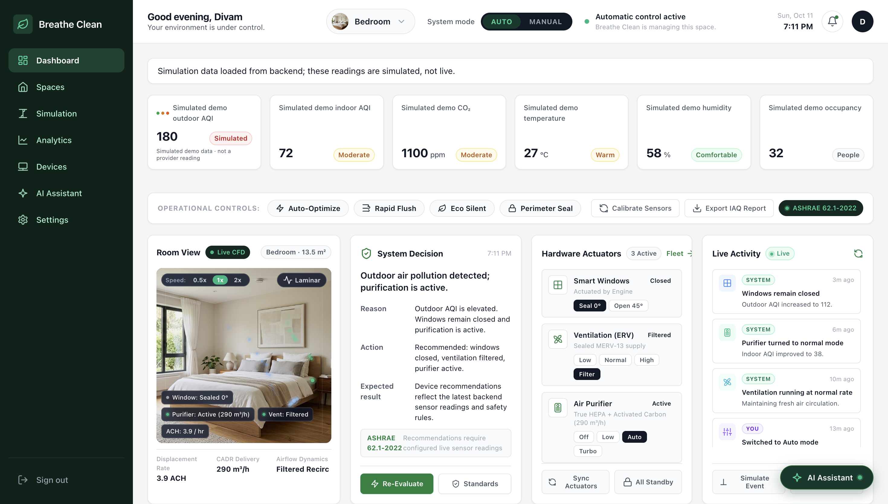
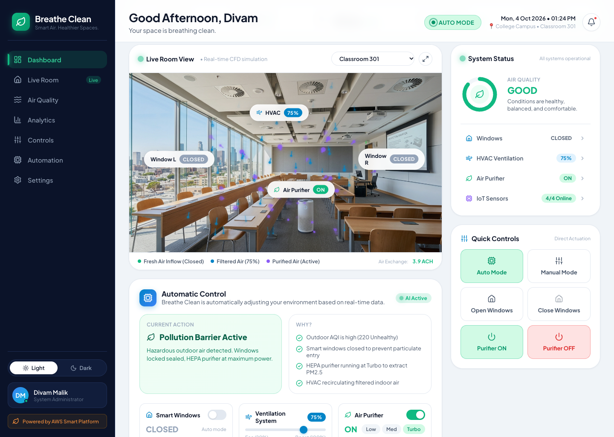
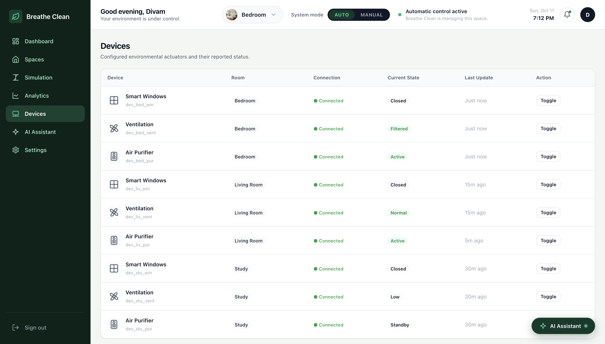
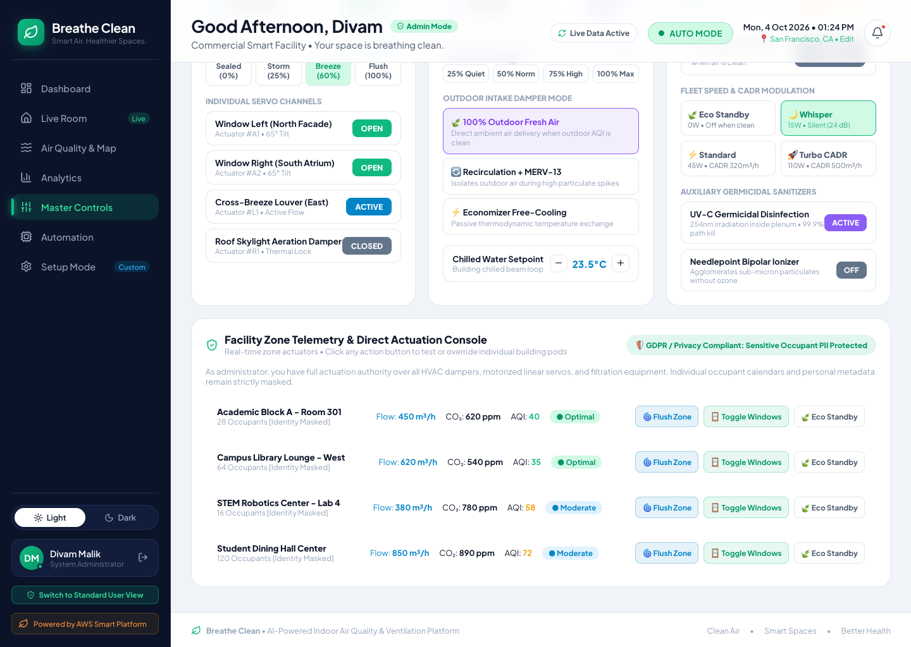

# 🍃 Breathe Clean
### *Autonomous Indoor Air Quality & Intelligent Ventilation Platform*

[](http://ec2-35-154-243-219.ap-south-1.compute.amazonaws.com)
[](http://ec2-35-154-243-219.ap-south-1.compute.amazonaws.com)
[](https://nodejs.org)
[](https://expressjs.com)
[](https://www.sqlite.org)
[](https://nodejs.org/api/test.html)
[](LICENSE)

> 🚀 **Live AWS Deployment:** [http://ec2-35-154-243-219.ap-south-1.compute.amazonaws.com](http://ec2-35-154-243-219.ap-south-1.compute.amazonaws.com)  
> 🏆 **Built for:** WeMakeDevs × AWS Environmental Hacks — **Track 01: Air**

---

## 💡 The Problem: The Indoor Air Quality Paradox

In major cities and across North India, winter air quality regularly spikes past hazardous levels (AQI 350–500+). Most people spend over 90% of their daily lives indoors, where they face a difficult paradox:

1. **Keep windows shut**: Carbon dioxide (CO₂) builds up rapidly past 1,000 ppm, causing fatigue, headaches, poor concentration, and respiratory distress.
2. **Open windows blindly**: Hazardous outdoor PM2.5 and toxic particulate smog flood indoors.
3. **Leave air purifiers on 24/7**: Purifiers consume substantial electricity continuously, even on days when the outdoor air is clean and free natural ventilation would be healthier and cheaper.

---

## 🍃 The Solution: What Breathe Clean Does

**Breathe Clean** is an autonomous indoor environmental orchestration platform. It connects real-time outdoor atmospheric telemetry with indoor sensor streams to intelligently control smart windows, HVAC ventilation, and HEPA air purifiers based on **ASHRAE 62.1 indoor ventilation standards**:

* 🪟 **Natural Ventilation First**: When outdoor air is clean and crisp, motorized windows open automatically to flush out stale air without spending a single watt on purifiers.
* ⚡ **Eco-Standby Energy Saver**: When both indoor and outdoor air quality are within safe limits, purifiers shut down automatically to prevent wasted electricity.
* 🛡️ **Pollution Shield**: The moment an outdoor smog spike occurs (AQI > 120), windows seal immediately, HVAC switches to safe indoor recirculation, and purifiers ramp up to maximum CADR.
* 💨 **Visual Airflow Particle Canvas**: An in-browser 2D fluid dynamics particle engine visualizes exactly how air moves across your rooms in real time (fresh window air, HVAC flow, and HEPA filtered streams).
* 🤖 **Explainable Decisions**: A built-in environmental assistant explains every automated decision with clear data rather than black-box guesses.

---

## 📸 Interface Showcase

### 🎛️ Real-Time Telemetry Dashboard & 2D Airflow Simulation
*Live indoor/outdoor atmospheric telemetry cards, 2D particle fluid dynamics canvas (room-1), and system status donut gauge.*



---

### 🛡️ Autonomous Response & Facility Controls

| Autonomous Stimulation Data Managent | Device Working Inspector |
| :---: | :---: |
|  |  |
| *Scroll bar for mannual conroll of the systems in the different panel.* | *Device managing panel to see everything in one place* |

| Functions to Analayze | Smart Ai-Assistant |
| :---: | :---: |
|  |  |
| *All function / formulas used to generate live data perfectly.* | *Interactive Smart AI-ASSISTANT to explaore the devices and explore the data and simulation by chatting.* |


---

## ☁️ AWS Cloud Architecture

Breathe Clean is architected and deployed on Amazon Web Services using the Free Tier:

```
┌─────────────────────────────────┐
│       Incoming Users / Browser  │
└────────────────┬────────────────┘
                 │ HTTP (Port 80)
                 ▼
┌────────────────────────────────────────────────────────┐
│  Amazon EC2 (Ubuntu 24.04 LTS — ap-south-1 Mumbai)     │
│  ├─ Nginx Reverse Proxy (Port 80 → Port 5001)          │
│  ├─ Node.js 22 LTS Runtime                             │
│  ├─ PM2 Cluster Process Manager                        │
│  ├─ Express 5 REST API + Static SPA Frontend           │
│  └─ SQLite Local Store (WAL Mode, scrypt auth)         │
└────────────────┬───────────────────────────────────────┘
                 │ IAM Role (BreatheClean_EC2_Profile)
                 ▼
┌────────────────────────────────────────────────────────┐
│  Amazon DynamoDB (BreatheClean_Telemetry)              │
│  └─ Cloud telemetry storage for live sensor events     │
└────────────────────────────────────────────────────────┘
```

* **Amazon EC2 (`t3.micro`)**: Hosts the application 24/7 in Mumbai (`ap-south-1`) behind an Nginx reverse proxy and PM2 process supervisor.
* **Amazon DynamoDB**: Stores live room telemetry streams and atmospheric observation events with sub-millisecond retrieval.
* **AWS IAM**: Provides keyless, secure instance profile permissions between EC2 and DynamoDB without storing hardcoded credentials.
* **Automated AWS Provisioning**: Includes a one-click AWS CLI script (`deploy/aws-provision-ec2.sh`) that provisions the VPC security group, key pair, and cloud-init bootstrap automatically.

---

## ⚙️ How the Autonomous Rule Engine Works

Breathe Clean follows deterministic, safety-validated thresholds aligned with ASHRAE 62.1:

| Condition | Outdoor Air | Indoor CO₂ / AQI | Autonomous Action |
| :--- | :---: | :---: | :--- |
| **Clean Air Day** | AQI ≤ 80 | Normal (< 800 ppm) | **Natural Ventilation**: Windows open, air purifier in Eco Standby (OFF). |
| **Outdoor Smog Spike** | AQI > 120 | Any | **Pollution Shield**: Windows instantly closed, purifier engaged at High. |
| **High Indoor CO₂** | AQI ≤ 100 | CO₂ > 800 ppm | **Fresh Air Flush**: Windows open to lower CO₂ safely. |
| **Stale Air (Outdoor Smog)** | AQI > 120 | CO₂ > 800 ppm | **Filtered Air Recirculation**: Windows stay closed; HVAC filtered intake active. |

---

## 🚀 Getting Started Locally

### Prerequisites
* **Node.js**: v22.0.0 or higher
* **npm**: v10.0.0 or higher

### 1. Clone & Install
```bash
git clone https://github.com/DivamMalik/Breathe-Clean.git
cd Breathe-Clean
npm install
```

### 2. Run the Development Server
```bash
npm run dev
```
Open **`http://localhost:5001`** in your browser. The single Express server serves both the frontend interface and the backend REST API on the same origin.

### 3. Run the Automated Test Suite
To run all **95 automated tests** (51 frontend tests + 44 backend tests):
```bash
npm test
```

---

## 📂 Project Structure

```text
Breathe-Clean/
├── Frontend/                 # Lightweight Vanilla JS Single-Page Application
│   ├── assets/images/        # High-resolution room photography & icons
│   ├── css/styles.css        # Responsive glassmorphic styling system
│   ├── js/                   # SPA controller, particle canvas, state, and view engine
│   │   ├── api.js            # Dynamic API client & telemetry bridge
│   │   ├── app.js            # Main application event router
│   │   ├── chatbot.js        # Explainable environmental decision assistant
│   │   ├── engine.js         # Client-side ventilation rule verifier
│   │   ├── state.js          # Reactive state store
│   │   ├── utils.js          # SVG chart utilities and helpers
│   │   └── views.js          # Onboarding, dashboard, and analytics views
│   ├── test/                 # 51 Frontend unit and integration tests
│   └── index.html            # Application entry point
├── backend/                  # Node.js 22 Express backend
│   ├── data/                 # SQLite WAL-mode database files
│   ├── src/
│   │   ├── auth/             # Session store & scrypt password security
│   │   ├── controllers/      # Sensor, device, decision, and account handlers
│   │   ├── routes/           # REST endpoints
│   │   ├── services/         # ASHRAE rule engine & live environmental providers
│   │   └── server.js         # Express server with reverse-proxy trust
│   ├── test/                 # 44 Backend unit & rule validation tests
│   └── package.json          # Backend dependencies
├── deploy/
│   ├── aws-provision-ec2.sh  # Automated AWS EC2 + security group launch script
│   └── setup-ec2.sh          # Ubuntu 24.04 Nginx + PM2 bootstrap script
├── docs/screenshots/         # Verified interface screenshots
├── .github/workflows/ci.yml  # Automated GitHub Actions test pipeline (Node 22)
├── Dockerfile                # Production Node 22 container specification
├── ecosystem.config.js       # PM2 production process configuration
├── package.json              # Unified root scripts
└── README.md                 # Project documentation
```

---

## 🛠️ Technology Stack

* **Frontend:** Vanilla JavaScript (ES6+), HTML5 Canvas 2D particle simulation, CSS3 Custom Tokens.
* **Backend:** Node.js 22 LTS, Express 5.
* **Database:** SQLite with WAL mode (`better-sqlite3`), Amazon DynamoDB for cloud telemetry.
* **Cloud & Infrastructure:** Amazon EC2 (`t3.micro`), AWS IAM instance profiles, Nginx 1.24, PM2.
* **Testing:** Native Node test runner (`node --test`), 95 test cases (100% passing).
* **CI/CD:** GitHub Actions with Node 22 matrix.

---

## 📄 License

Distributed under the [MIT License](LICENSE).
