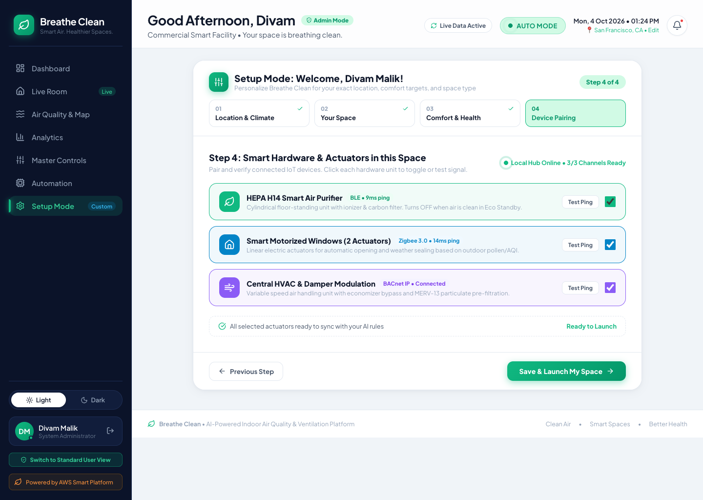
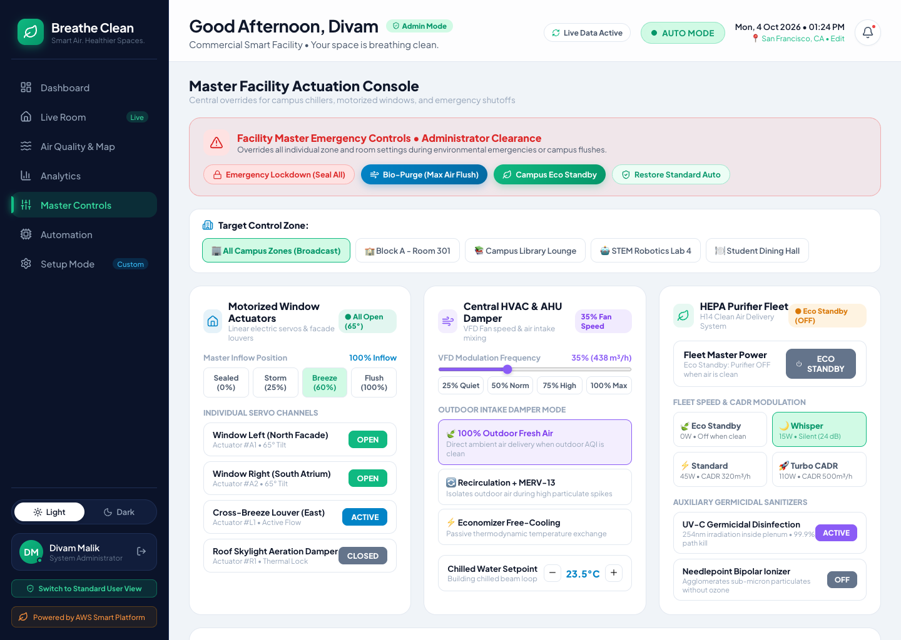
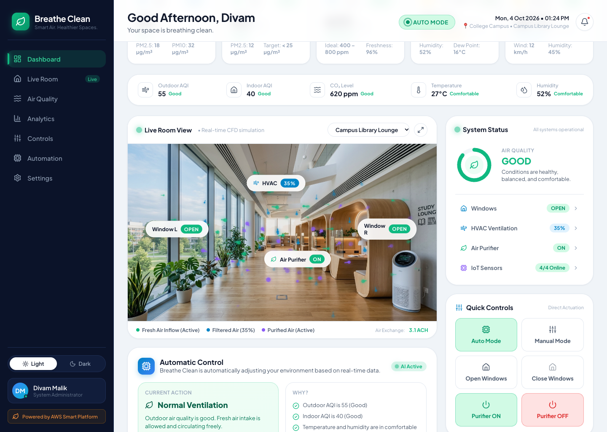
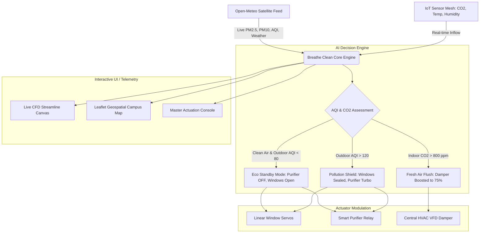

# 🍃 Breathe Clean
### *Autonomous Indoor Air Quality & Intelligent Ventilation Platform*

[](https://react.dev)
[](https://vitejs.dev)
[](https://open-meteo.com)
[](https://leafletjs.com)
[](https://aws.amazon.com)
[](LICENSE)

---

## 🏆 Hackathon Project Overview

**Breathe Clean** is an autonomous indoor environmental orchestration platform built for smart campuses, commercial buildings, and modern homes. It intelligently bridges architectural aerodynamics with smart hardware automation:

1. **Natural Ventilation First**: When outdoor air is crisp and clean, motorized window actuators open automatically for natural oxygen circulation.
2. **Eco Standby Energy Conservation**: When indoor and outdoor air quality are healthy, the HEPA air purifier is **automatically switched OFF** to eliminate redundant power draw.
3. **Pollution Barrier & Displacement Flush**: During outdoor smog spikes or hazardous particulate events, windows instantly seal, HVAC dampers isolate outside air, and HEPA purifiers ramp to Turbo CADR.
4. **Privacy-Preserving Administrator RBAC**: Facility administrators gain master actuation command over all campus dampers and chillers, while sensitive occupant identities remain strictly masked under GDPR standards.

---

## 📸 Interactive System Showcase

| Master Facility Actuation Console (Admin) | Smart Hardware Pairing (Setup Mode Step 4) |
|:---:|:---:|
|  |  |

| Privacy-Preserving Telemetry & Zone Actions | Real-Time CFD Room Airflow Simulation |
|:---:|:---:|
|  |  |

---

## ✨ Key Features & Innovations

### 1. 🛰️ Real-Time Environmental Satellite Telemetry
* Integrates directly with global **Open-Meteo APIs** for live ambient weather (temperature, humidity, wind velocity) and atmospheric particulate data (PM2.5, PM10, AQI).
* Browser **GPS Geolocation auto-detect** with instant coordinate reverse-mapping and preset global metropolitan hubs.

### 2. 🎛️ Master Facility Actuation Command Center (Admin Mode)
* **Master Emergency Bar**: One-click building lockdown (`Seal All`), high-volume `Bio-Purge Flush`, `Campus Eco Standby`, and `Restore Standard Auto`.
* **Motorized Window Station**: Master angle sliders (`0% Sealed` to `100% Flush`) and 4 individual linear actuator servo channels.
* **Central HVAC & Damper Modulation**: VFD fan frequency slider (0% to 100%) and 3 damper modes (`100% Outdoor Fresh Air`, `Recirculation + MERV-13`, `Economizer Free-Cooling`).
* **HEPA Fleet & Sanitizers**: Master fleet power with 4 CADR speed levels, 254nm UV-C germicidal disinfection, and needlepoint bipolar ionization.
* **Privacy-Preserving Telemetry**: Aggregate zone telemetry with individual occupant identities masked (`[Identity Masked]`).

### 3. 💨 Dynamic CFD Streamline Particle Simulator
* High-performance HTML5 Canvas fluid dynamics particle engine rendering real-time indoor aerodynamics:
  * 🟢 **Natural Fresh Air** (Green streamlines from motorized windows)
  * 🔵 **Central HVAC Airflow** (Cyan streamlines from ceiling supply diffuser)
  * 🟣 **HEPA Purified Stream** (Purple laminar flow from cylindrical floor unit)

### 4. 🗺️ Geospatial Campus Sensor Map
* Interactive **Leaflet OpenStreetMap** monitoring campus buildings, individual classroom AQI pins, and pollutant distribution.

### 5. 🤖 Autonomous Explainable AI Engine
* Real-time rule engine following ASHRAE 62.1 indoor ventilation standards:
  * **Rule 1: High Outdoor Particulates Shield** (Seals windows when AQI > 120).
  * **Rule 2: Carbon Dioxide Alertness Flush** (Opens windows when CO₂ > 800 ppm).
  * **Rule 3: Eco Standby Power Saver** (Turns purifier OFF when indoor AQI ≤ 50 and outdoor air is clean).
  * **Rule 4: Night-Time Thermal Purge** (Free natural economizer cooling).

### 6. 🚀 Personalized 4-Step Setup Wizard
* First-time onboarding gateway customized for any occupant or facility manager:
  * **Step 1**: Location & Meteorological Climate (with live satellite preview)
  * **Step 2**: Space Profile (Rooms, scale, square footage, window count)
  * **Step 3**: Comfort & Health Policies (Target temperature, CO₂ ceiling, Eco standby)
  * **Step 4**: Connected Hardware Pairing & Actuator Ping Diagnostics

---

## 🏛️ System Architecture



---

## 📂 Modular Codebase Structure

```text
Hackathon/
├── docs/
│   └── screenshots/          # Production UI captures & flow proofs
├── src/
│   ├── assets/               # High-res room backgrounds (Classroom, Library)
│   ├── components/
│   │   ├── common/           # Shared reusable utilities
│   │   │   ├── AirflowCanvas.jsx    # Fluid particle engine
│   │   │   ├── CampusMap.jsx        # Leaflet campus map
│   │   │   └── LiveChart.jsx        # Real-time multi-series SVG chart
│   │   ├── layout/           # App shell components
│   │   │   ├── AppFooter.jsx        # Footer branding
│   │   │   ├── Sidebar.jsx          # Collapsible responsive sidebar
│   │   │   └── TopHeader.jsx        # Synchronized status & quick controls
│   │   ├── modals/           # Modal dialogs
│   │   │   ├── NotificationModal.jsx
│   │   │   ├── SimulationModal.jsx
│   │   │   └── UserSettingsModal.jsx
│   │   ├── views/            # Dedicated application pages
│   │   │   ├── AirQualityMapView.jsx
│   │   │   ├── AnalyticsView.jsx
│   │   │   ├── AutomationView.jsx
│   │   │   ├── DashboardView.jsx
│   │   │   ├── LiveRoomView.jsx
│   │   │   └── MasterControlsView.jsx
│   │   ├── AuthScreen.jsx    # Standalone Sign In / Sign Up gateway
│   │   └── SetupWizard.jsx   # 4-step interactive onboarding
│   ├── constants/
│   │   └── mockData.js       # Pre-configured zones, telemetry, notifications
│   ├── services/
│   │   └── airQualityApi.js  # Live Open-Meteo REST client & GPS detector
│   ├── App.css
│   ├── App.jsx               # Orchestrator with state & RBAC routing
│   ├── index.css             # Design system with light/dark themes
│   └── main.jsx
├── .github/
│   └── workflows/
│       └── deploy.yml        # GitHub Actions continuous deployment
├── package.json
├── vite.config.js
└── README.md
```

---

## 🚀 Quick Start & Local Setup

### Prerequisites
* **Node.js**: v18.0.0 or higher
* **npm**: v9.0.0 or higher

### Installation
```bash
# Clone the repository
git clone https://github.com/divammalik/Hackathon.git

# Navigate to the project directory
cd Hackathon

# Install dependencies
npm install

# Start the Vite local development server
npm run dev
```

Visit **`http://localhost:5173`** in your browser.

---

## 👥 Demo Credentials & Test Accounts

The platform includes two one-click quick login credentials on the entry gateway:

| Account | Role | Features Available |
|:---|:---|:---|
| **Divam Malik** | `System Administrator` | Master Facility Emergency Bar, 12-channel window servos, VFD HVAC Damper slider, HEPA Fleet speeds, UV-C & Ionizer switches, Privacy-masked zone telemetry. |
| **Sarah Chen** | `Personal Space Occupant` | Personal room motorized windows, whisper air purifier toggle, target temperature preferences. |

---

## 🛠️ Technology Stack

| Layer | Technologies |
|:---|:---|
| **Frontend Framework** | React 19, Vite 8, JavaScript (ES Modules) |
| **Styling & Design System** | Modern Vanilla CSS, CSS Grid, Glassmorphism, Dark/Light Themes |
| **Icons & Micro-UI** | Lucide React |
| **Geospatial Mapping** | Leaflet 1.9, OpenStreetMap Tiles |
| **Fluid Simulation** | HTML5 Canvas 2D Particle System (Dynamic Vector Math) |
| **Live Telemetry API** | Open-Meteo Meteorological & Global Atmospheric Dispersion API |
| **Deployment & CI/CD** | GitHub Pages & GitHub Actions |

---

## 📄 License

This project is licensed under the **MIT License** - see the [LICENSE](LICENSE) file for details. Built for the Hackathon with ❤️ by **Divam Malik**.
